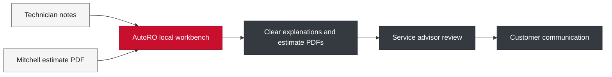

<p align="center">
  
</p>

<h1 align="center">AutoRO · Communication Layer</h1>
<p align="center"><strong>Built in the bay. Clear at the counter.</strong><br>Local AI tools for independent automotive shops.</p>

<p align="center">
  
  
  
  
</p>

AutoRO turns technician notes and Mitchell estimate data into clear, customer-ready explanations while keeping the service advisor in control. It brings translation, estimate PDFs, BG coverage, and shop reporting into one local workbench.

**Version 1.3.0-beta.1** is the official Beta release for live shop testing. The portable distribution carries the local model and supporting tools; this repository contains the application source, launchers, and documentation.

### From the bay to the customer



| In the shop | What AutoRO helps you do |
| --- | --- |
| 🔧 Technician notes | Turn rough findings into explanations an advisor can review and share. |
| 📄 Estimates | Build pre-estimate, in-shop, and custom build PDFs from Mitchell data. |
| 🛡️ BG coverage | Prepare coverage cards using local supporting rules. |
| 📊 Shop operations | Review advisor activity, translation statistics, and monthly digests. |

**Local processing · Advisor reviewed · Source-controlled pricing**

No cloud services, no npm, no React, no accounts.

[Startup](#-native-startup) · [Beta workflows](#current-beta-workflows) · [Live testing guide](docs/BETA_LIVE_TESTING.md) · [Sales guide](docs/AutoRO_Sales_Guide.md) · [HTML presentation](html_presentation/autoro_presentation.html)

---

AutoRO is intentionally loopback-only. Supported launchers bind the web app to
`127.0.0.1`, and the application rejects non-loopback clients, non-loopback
Host headers, and cross-site state-changing browser requests. Do not publish or
reverse-proxy the service onto a shop LAN; network mode requires a separate
authenticated deployment design.

## Current Beta Workflows

- **Translator:** rewrites rough technician notes into advisor/customer language.
- **Pre-estimate - out of shop:** parses the uploaded Mitchell PDF, preserves its financial data, and adds concise customer-facing explanations. If AI enrichment is unavailable, source-grounded local wording is used.
- **Estimate - in shop:** combines the Mitchell estimate with a customer concern and technician findings, including detailed labour and parts breakdowns.
- **Custom build package:** combines polished project wording with the detailed in-shop parts/labour presentation. AI is limited to spelling, grammar, and cleaned titles; scope and prices remain parser-controlled.
- **BG Coverage, Advisor Queue, Management, and Operations:** remain local supporting workflows.

Generated estimate filenames carry the selected workflow and the original source identity, for example:

```text
OUT_OF_SHOP_ESTIMATE_DAX_NADERI_GX460.pdf
IN_SHOP_ESTIMATE_DAX_NADERI_GX460.pdf
CUSTOM_BUILD_DAX_NADERI_GX460.pdf
```

Regenerating the same workflow for the same source estimate replaces that workflow's prior output instead of adding timestamp-heavy duplicates.

## Current Model Runtime

- One Qwen3 llamafile server is shared on `http://localhost:8080`.
- Qwen's hidden reasoning is disabled for structured estimate requests where supported.
- Custom Build waits no more than 15 seconds for language cleanup, then continues with local wording.
- In-shop analysis waits no more than 45 seconds, then continues with source-grounded mappings.
- Ollama remains an optional configured provider; the portable Beta defaults to llamafile.

Model files:

```text
<AutoRO drive>/Models/Qwen3-4B-Instruct-2507-Q4_K_M.gguf
```

*Note: CPU execution thread count is capped at 8 by default to prevent core contention and thread-scheduling latency (particularly on modern hybrid CPUs with P-cores and E-cores).*

---

## ⚙️ Native Startup

### Windows Launch (Primary & Portable)
This drive is fully equipped for Windows. It runs entirely on-board without installing anything on the host computer.
Recommended bat script from the drive root:
```text
Double Click to Start AutoRO Windows Useres .bat
```
The launcher starts the Qwen model and AutoRO server, then opens the browser as soon as the web app is ready while model loading continues. Keep the two command windows open while AutoRO is running.

### Linux Launch
Launch the one-step optimizer script:
```bash
<AutoRO drive>/start_autoro_linux.sh
```
*Note: The Linux script is fully automated. If you haven't run it before, it will automatically build a local Python environment and securely install dependencies offline from `Tools/Wheelhouse_Linux`. You only need to ensure `python3` and `poppler-utils` are installed on the host machine using the provided helper script if needed:*
```bash
sudo bash install_linux_dependencies.sh
```

Check the app launcher config without starting the server:
```bash
<AutoRO drive>/start_autoro_linux.sh --check
```

---

## 📂 USB Directory Layout

To maintain a clean user-facing experience when opening the USB drive, runtime state and configuration files are grouped under the `/runtime` directory:

```text
<AutoRO drive>/
├── runtime/                        # Holds all runtime state and databases
│   ├── Database/autoro.db          # Core sqlite database
│   ├── logs/                       # Server and model diagnostic logs
│   ├── data/                       # Local official BG rules database
│   └── reports/                    # Monthly Operations digest spreadsheets (.xlsx)
├── docs/                           # Documentation (e.g. Audit Reports)
├── dev_tools/                      # Developer-only health check and testing scripts
├── app/                            # FastAPI Python backend code
├── estimate_conversion/            # Estimate conversion pipeline and templates
├── Llamafile/                      # Llamafile executables and start scripts
├── Models/                         # GGUF models
├── Tools/                          # Bundled dependencies for Windows (Python, Poppler)
├── .env                            # System configuration environment variables
├── README.md                       # Project documentation
└── start_autoro_linux.sh           # Native Linux orchestrator
```

---

## 🩺 Estimate Preflight Sanity Checks

To act as a backstop for human errors in imported Mitchell estimates, a preflight check runs automatically before building any PDF copy. It identifies and flags high-signal issues, presenting them as a consolidated bulleted list to the service advisor:

*   **Parts Without Labor**: Flags any job line where parts have a positive cost but labor is `0.0` hours (with support for "No Charge" / "NC" overrides).
*   **Misplaced Parts**: Detects when steering rack parts (e.g. `Rack and Pinion`) are listed under a steering pump job title instead of a steering rack replacement job, suggesting that they belong to the rack line.
*   **Duplicate/Split Lines**: Identifies duplicate lines for the same steering component (pump or rack) in the same estimate where one line is left with `0.0` labor hours.

The service advisor has full control to either cancel and correct the original estimate in Mitchell, or suppress the warning and build the PDF as is.

---

## 🧹 Storage Management & Self-Cleaning

To prevent disk bloat on the USB drive, a background cleanup service runs automatically when the FastAPI application starts up. It scans directories and purges old files:
*   **Log files** in `runtime/logs/` are deleted if older than **14 days**.
*   **Orphaned PDF uploads** in `estimate_conversion/workspace/uploads/` are deleted if older than **1 day**.
*   **JSON parsing import records** in `estimate_conversion/workspace/import_records/` are deleted if older than **30 days**.
*   **SQLite recovery backups** are created once per UTC day and retained for **14 days** (configurable with `AUTORO_DB_BACKUP_DAYS`). On startup, AutoRO checks database integrity and restores the newest healthy backup if the active database is damaged, while preserving the damaged file for investigation.

SQLite runs in write-ahead logging mode with full synchronous writes and a 30-second busy timeout, reducing data loss from interrupted writes and avoiding transient "database is locked" failures.

---

## 📝 Structured Logging & Request Tracing

The application features structured JSON logging and correlation tracking to simplify troubleshooting across services:
*   All logs output in a unified **JSON format** capturing timestamps, levels, loggers, messages, and trace keys.
*   An incoming HTTP middleware generates and assigns an `X-Correlation-ID` header. This correlation ID attaches contextually to every log statement within that request flow.
*   Unhandled exceptions generate detailed stack traces mapped back to the request's correlation ID, returning a secure, clean HTTP 500 error code.

---

## 📖 API Documentation & Contracts

FastAPI generates formal interactive OpenAPI documentation at:
```text
http://127.0.0.1:8000/docs
```
Endpoints return explicit Pydantic response models, providing complete request-to-response schemas.

### Primary Pages & APIs:
*   `/` - Dashboard.
*   `/translate` - Technician-note translator with qualifier chips.
*   `/estimate-conversion` - Pre-estimate, in-shop estimate, and Custom Build PDF workflows. Imported pricing remains the source of truth; AI may improve wording but cannot modify financial fields.
*   `/management` - Missed details and translation statistics.
*   `/manage` (or `/operations`) - Protected operations monthly digest.
*   `/bg` - BG coverage card builder.
*   `/cases` & `/knowledge` - Approved translation case library.

---

## 🔒 Protected Operations Digest
Security code: `2470`

Operations reports are read from: `runtime/reports`
The current demo month is: `runtime/reports/2026-06`

Operations API:
```text
GET  /api/operations/digest
POST /api/operations/ask
Header: X-Manager-Code: 2470
```

---

## ⚙️ Environment Variables (`.env`)

Default USB environment:
```text
MODEL_PROVIDER=llamafile
AUTORO_MODEL=Qwen3-4B-Instruct-2507-Q4_K_M.gguf
LLAMAFILE_BASE_URL=http://localhost:8080

AUTORO_ESTIMATE_PROVIDER=llamafile
AUTORO_ESTIMATE_MODEL=Qwen3-4B-Instruct-2507-Q4_K_M.gguf
AUTORO_ESTIMATE_LLAMAFILE_URL=http://localhost:8080

AUTORO_DB_PATH=runtime/Database/autoro.db
AUTORO_REPORTS_ROOT=runtime/reports
AUTORO_MANAGEMENT_CODE=2470
AUTORO_REQUEST_TIMEOUT=60
AUTORO_MAX_RESPONSE_TOKENS=512

# Optional estimate/PDF identity. The Beta defaults to the AutoRO pilot block.
AUTORO_SHOP_NAME=AutoRO
AUTORO_SHOP_EMAIL=autoroestimate@gmail.com
# AUTORO_SHOP_ADDR=Built in the Bay - Calgary, Alberta\nPowered by Real Shop Experience\nLocal Processing - Advisor Reviewed
```

Customer phone numbers may still appear in customer-information fields imported from the source estimate. The AutoRO pilot identity does not publish a shop street address, shop telephone number, or fax number.

---

## Estimate Troubleshooting

- **Status briefly shows Error while a PDF still completes:** inspect `runtime/logs/autoro_*.log`. Beta workflows continue with local fallback wording when language enrichment times out.
- **Custom Build returns a refresh message:** refresh `/estimate-conversion`; the JavaScript asset is versioned to prevent stale browsers from using the retired proposal route.
- **Model is slow:** the bundled llamafile may run CPU-only even when an NVIDIA device is detected. The model log will state whether GPU layers were accepted.
- **No text in an in-shop/custom workflow:** enter at least a concern, technician finding, build goal, or intended-use note. Blank submissions are rejected before AI analysis.
- **Source wording is poor:** correct job titles/descriptions in Mitchell when practical. AutoRO performs conservative spelling cleanup but does not rewrite part numbers or silently change scope.

---

## 🛠️ Local Linux Native Setup (Development)

From the AutoRO root:
1. Set up a virtual environment:
   ```bash
   python3 -m venv .venv
   source .venv/bin/activate
   pip install -r requirements.txt
   ```
2. Run startup check and launch:
   ```bash
   ./start_autoro_linux.sh --check
   ./start_autoro_linux.sh
   ```
